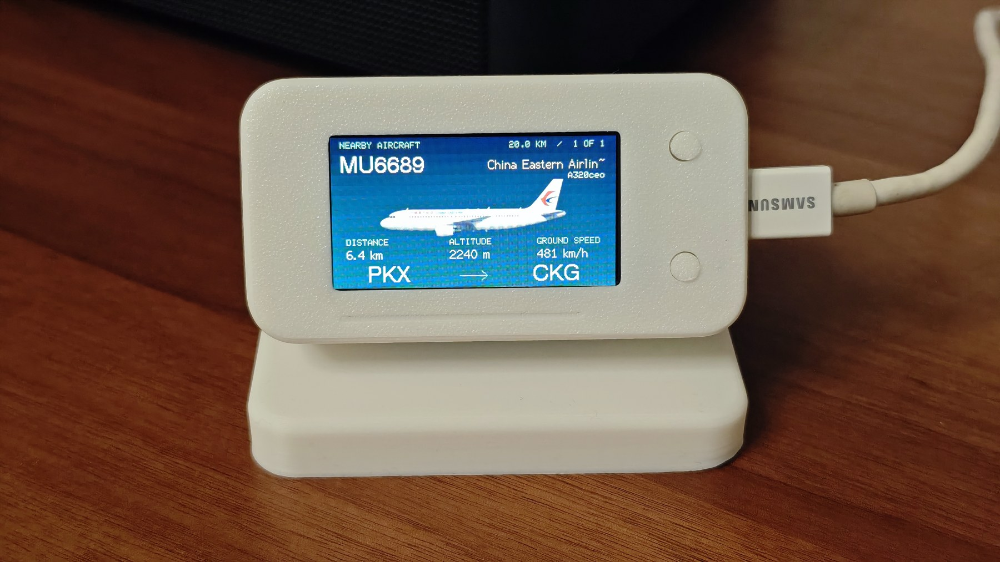
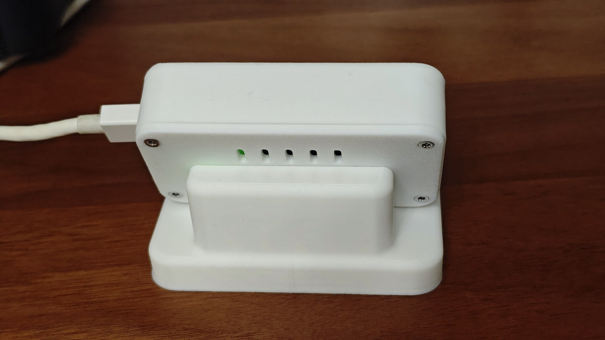

# FlightDesk · 桌面航班显示器

用一块 **LILYGO T-Display-S3**，看看附近飞过的是哪架飞机。

仅通过 Wi-Fi 和 API 获取飞机位置，不需要 ADS-B 天线、GPS 或其他接收硬件。飞机进入设定范围时亮屏显示，离开后自动关闭背光，后台继续扫描。



> 照片是已装配设备，展示了本地另行导入的飞机涂装。公开源码默认使用飞机图标，不附带授权尚未明确的涂装位图；可以按[素材说明](docs/ARTWORK.md)导入自己有权使用的图片。

## 功能

- 航班卡片：航班号、航司、机型、距离、高度、地速、出发／到达机场。
- 自动按距离排序，多架飞机每 10 秒轮播；也可手动切换。
- 待机大时钟与扫描雷达；无有效飞机时关闭背光，有飞机时自动唤醒。
- 网页修改观察点、搜索半径、刷新频率、屏幕方向和 Wi-Fi；设置保存在设备 NVS。
- 检查上游数据年龄和单架位置年龄，过滤地面、过期和范围外飞机；接口错误不会伪装成“没有飞机”。
- 配套本地 API 适配器及圆角方盒外壳，提供 STEP、STL 和建模脚本。

## 硬件

**标准 LILYGO T-Display-S3**，ESP32-S3、ST7789 170×320、16MB Flash／8MB PSRAM。此引脚配置不适用于其他 T-Display 型号。

仅开发板、USB 供电即可运行。照片外壳适配背面两排直排针，PCB 背面至针尖 **8.25 mm**。底座配重 **34×20×4.85 mm**、中心孔 **Ø6.2 mm**；M3 自攻螺钉锁进打印定位柱，用压片固定配重。

## 快速开始

### 1. 启动局域网 API

需要 Node.js 20 或更新版本：

```sh
cd tools/flight-source-probe
npm ci
HOST=0.0.0.0 PORT=8787 node server.cjs
```

让 ESP32 与服务电脑处于同一可信局域网，并允许设备访问服务端口。服务默认只监听 `127.0.0.1`；上面的 `HOST` 显式开启局域网访问。无需把服务暴露到公网。

此适配器接入飞常准网页使用的数据服务，**是非官方适配，不是获官方保证的免费开放 API**；可能改版、限流或失效。使用须符合数据提供方的条款和授权，仓库许可证不授予飞行数据使用权。实现和可替换接口见 [API 文档](docs/API.md)。

### 2. 配置 API 地址并编译

安装 [PlatformIO](https://platformio.org/)，在项目根目录执行：

```sh
cp include/local_config.example.h include/local_config.h
# 将 local_config.h 中 YOUR_SERVER_IP 改为你的 API 服务电脑的局域网 IP
pio run
pio device list
pio run -t upload --upload-port YOUR_SERIAL_PORT
```

`local_config.h` 已加入忽略列表。默认地址为 `http://flight-api.local:8787`，通常应改成实际 IP。HTTPS 地址使用内置根证书验证，HTTP 仅用于配置的本地位置服务。

首次烧录若连接失败：按住 BOOT，点按 RST，再松开 BOOT，然后重试。

### 3. 配网与设置观察点

连接热点 **FlightDesk-Setup**，密码 **flightdesk**，访问 `http://192.168.4.1/`，填入家庭 Wi-Fi。联网后访问 `http://flightdesk.local/` 或设备显示的 IP。

**必须在网页填写你的观察点经纬度（WGS84）**，公开版默认 `(0, 0)`。默认搜索**半径 20 公里**，每 10 秒刷新；范围表示水平圆形距离。网页可调整半径和刷新间隔。Wi-Fi 密码不写进源码，也不通过状态接口回显。

可选 USB 配网：

```sh
python3 -m pip install pyserial
python3 tools/configure.py --port YOUR_SERIAL_PORT --wifi
```

## 按键

| 按键 | 短按 | 长按 |
| --- | --- | --- |
| GPIO0 | 下一架飞机 | 卡片／雷达切换 |
| GPIO14 | 卡片／雷达切换 | 开启配网热点 |

熄屏后任一按键先唤醒时钟 15 秒；有飞机时自动亮屏。无飞机时只是关闭背光，Wi-Fi 和查询任务继续运行。

## 外壳与打印

最新版本：[圆角方盒 V6](enclosure/soft-box-v6/README.md)。[STL 零件](enclosure/soft-box-v6/stl)、[完整 STEP](enclosure/soft-box-v6/flightdesk-soft-box-v6.step) 可直接下载。尺寸、螺丝、打印方向与配重固定方式见装配说明。先打印排针试配片，再打印完整壳体。



`model.py` 使用 CadQuery，并依赖仓库中的 `enclosure/flightdesk-assembly.step` 保留原安装基准；这是基于已有实体继续建模的流程，并非完全从零参数化的板卡模型。STEP 和 STL 不需要运行建模软件即可使用。

## 数据与限制

位置 → 本地 API → ESP32 距离／新鲜度过滤 → 航班卡片／雷达 → 自动背光。

起降机场优先采用位置服务返回值；缺失时由 ADSBdb、ADSB.lol 航线库补充。航线数据库不能保证当天改航或临时任务。机型、注册号和涂装匹配可能缺失；未知信息保留未知，不用其他航司的图冒充。B-4080 的少量公开身份补充按注册号和机身地址共同匹配，不按 OM 开头的呼号猜测航司。

高度由气压高度英尺换算为米，**不是离地高度**；地速由节换算为 km/h。数据覆盖、延迟、漏报取决于上游服务，不能用于航空导航。

## 开发与验证

```sh
pio run
python3 tools/test_native.py
cd tools/flight-source-probe && npm ci && npm test
```

固件固定使用 PlatformIO espressif32 6.5.0、TFT_eSPI 2.5.43、ArduinoJson 7.4.2。时钟字体已替换为可再分发的 DejaVu Sans；重建字形：

```sh
python3 -m pip install -r requirements-dev.txt
python3 tools/build_clock_font.py
```

诊断接口：`/api/state`、`/api/config`、`/screen.bmp`。设置与截图服务没有用户认证，仅面向可信家庭局域网。

公开版 **0.5.5** 基于实机 0.5.4 整理，移除了私人位置、局域网地址、历史抓包、日志、专有字形与未明确授权的素材。发布检查包含源码构建和本地测试，不会重新烧录作者设备。

## 许可与致谢

原创固件、工具、文档及外壳设计使用 [MIT License](LICENSE)。第三方依赖、字体、航空公司标志、照片中展示的涂装及外部数据各自保留其权利，详见 [THIRD_PARTY.md](THIRD_PARTY.md)。

感谢 [LILYGO](https://github.com/Xinyuan-LilyGO/T-Display-S3)、[PlaneSlate](https://github.com/PlaneSlate/liveries)、[ADSBdb](https://www.adsbdb.com/) 和 [ADSB.lol](https://api.adsb.lol/docs) 提供的硬件资料、设计启发与数据工具。本项目与上述组织及飞常准没有隶属关系。
